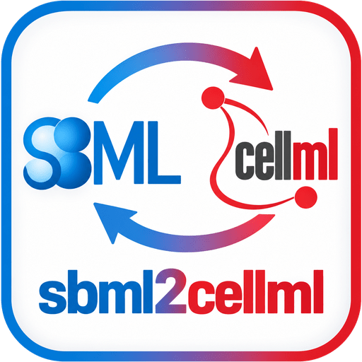
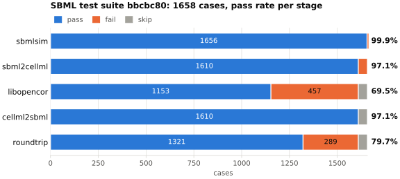
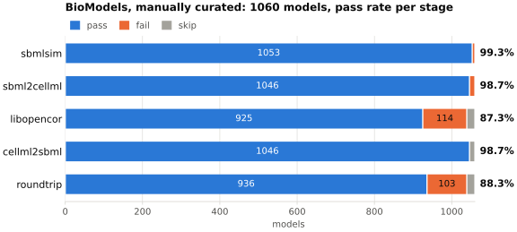
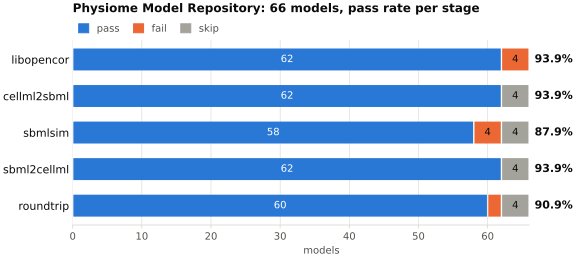
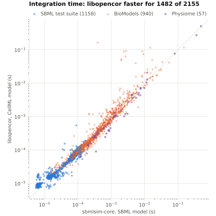

# sbml2cellml: conversion between SBML and CellML
[](https://github.com/matthiaskoenig/sbml2cellml/actions/workflows/ci-cd.yml) [](https://matthiaskoenig.github.io/sbml2cellml) [](https://pypi.org/project/sbml2cellml/) [](https://pypi.org/project/sbml2cellml/) [](https://opensource.org/licenses/MIT)

`sbml2cellml` converts between the [Systems Biology Markup Language (SBML)](https://sbml.org) and [CellML 2.0](https://cellml.org), with documentation available from [https://matthiaskoenig.github.io/sbml2cellml](https://matthiaskoenig.github.io/sbml2cellml).

Features include

- conversion of compartments, parameters, species, assignment and rate rules, reactions and events into a single CellML component
- conversion of the units: unit definitions, the units of numbers and, for a model with a complete unit annotation, the units of every variable
- names, notes, SBO terms, annotations and the model history as RDF next to the CellML model, restored in the conversion back to SBML
- conversion of CellML models to SBML: parameters with rules, unit definitions and units of numbers, resets as events, imports resolved, CellML 1.0 and 1.1 read in the permissive mode of libcellml, the components optionally as `comp` submodels (`--hierarchical`)
- that conversion in rust (`crates/`, the module `sbml2cellml._rust`), which converts a model about 48 times faster than the conversion through libcellml, converts models the analyser of libcellml refuses and runs in a browser; `--engine python` converts with libcellml instead
- the online converter of the documentation, which converts a CellML model to SBML in the browser with a WebAssembly module of the rust converter, without an upload ([online converter](https://matthiaskoenig.github.io/sbml2cellml/#online-converter))
- conversion of a hierarchical SBML model: the `comp` submodels are flattened before the model becomes CellML
- validation of the result with libcellml
- timecourse simulation of the SBML with sbmlsim-core and of the CellML with libopencor, both optional
- the `sbml2cellml` and `cellml2sbml` command lines
- the SBML test suite harness: every semantic case through both converters and both simulators, results on the [SBML test suite](https://matthiaskoenig.github.io/sbml2cellml/testsuite/) page
- the same check for the manually curated models of [BioModels](https://www.biomodels.org), results on the [BioModels](https://matthiaskoenig.github.io/sbml2cellml/biomodels/) page
- the same check for the CellML models of the [Physiome Model Repository](https://models.physiomeproject.org), from the CellML side, results on the [Physiome](https://matthiaskoenig.github.io/sbml2cellml/physiome/) page
- an overview of which models of the three checks work, on the [Models](https://matthiaskoenig.github.io/sbml2cellml/models/) page
- the wall time of the two simulators over the same models, on the [Benchmarks](https://matthiaskoenig.github.io/sbml2cellml/benchmarks/) page

```bash
pip install sbml2cellml
sbml2cellml model.xml -o model.cellml
cellml2sbml model.cellml -o model.xml
```

In the SBML to CellML direction the delay symbol and the delay of an event are not converted, and libopencor applies no reset, see the [conversion issues](https://matthiaskoenig.github.io/sbml2cellml/conversion-issues/).

# SBML test suite
Every semantic case of the [SBML test suite](https://github.com/sbmlteam/sbml-test-suite) is simulated with [sbmlsim-core](https://matthiaskoenig.github.io/sbmlsim-core/) (`sbmlsim`), converted to CellML (`sbml2cellml`), simulated with libopencor (`libopencor`), converted back to SBML (`cellml2sbml`) and simulated with sbmlsim-core again (`roundtrip`). The details are on the [SBML test suite](https://matthiaskoenig.github.io/sbml2cellml/testsuite/) page.

<picture>
  <source media="(prefers-color-scheme: dark)" srcset="https://raw.githubusercontent.com/matthiaskoenig/sbml2cellml/develop/docs/images/testsuite_dark.svg">
  
</picture>

# BioModels
The manually curated SBML models of [BioModels](https://www.biomodels.org) go through the same roundtrip. They have no expected results, so the sbmlsim-core simulation of the original model over 100 time units (`sbmlsim`) is what the libopencor simulation of the CellML (`libopencor`) and the sbmlsim-core simulation of the SBML converted back (`roundtrip`) are compared with. The details are on the [BioModels](https://matthiaskoenig.github.io/sbml2cellml/biomodels/) page.

<picture>
  <source media="(prefers-color-scheme: dark)" srcset="https://raw.githubusercontent.com/matthiaskoenig/sbml2cellml/develop/docs/images/biomodels_dark.svg">
  
</picture>

# Physiome Model Repository
The curated CellML models of the [Physiome Model Repository](https://models.physiomeproject.org), real world models of many components and mostly CellML 1.0 and 1.1 documents, go through the same pipeline from the CellML side: libopencor simulates the published model (`libopencor`), `cellml2sbml` converts it to SBML (`cellml2sbml`), sbmlsim-core simulates that (`sbmlsim`), `sbml2cellml` converts it back (`sbml2cellml`) and libopencor simulates the roundtrip (`roundtrip`). The details are on the [Physiome](https://matthiaskoenig.github.io/sbml2cellml/physiome/) page.

<picture>
  <source media="(prefers-color-scheme: dark)" srcset="https://raw.githubusercontent.com/matthiaskoenig/sbml2cellml/develop/docs/images/physiome_dark.svg">
  
</picture>

# Models and benchmarks
The [Models](https://matthiaskoenig.github.io/sbml2cellml/models/) page lists every model of the three checks with the stages it passes, so which models work is visible in one table. The [Benchmarks](https://matthiaskoenig.github.io/sbml2cellml/benchmarks/) page compares the two simulators over the models both of them run: the integration time of libopencor against the integration time of sbmlsim-core, and the median setup of each of them per check.

<picture>
  <source media="(prefers-color-scheme: dark)" srcset="https://raw.githubusercontent.com/matthiaskoenig/sbml2cellml/develop/docs/images/benchmarks_dark.svg">
  
</picture>

If you have any questions or issues please [open an issue](https://github.com/matthiaskoenig/sbml2cellml/issues).

# How to cite
[](https://doi.org/10.5281/zenodo.22829187)

If you use `sbml2cellml` please cite the archived software on [Zenodo](https://doi.org/10.5281/zenodo.22829187):

> König, M. (2026). *sbml2cellml: conversion of SBML models to CellML* (Version 0.4.3) [Computer software]. Zenodo. https://doi.org/10.5281/zenodo.23554440

```bibtex
@software{konig_sbml2cellml,
  author    = {König, Matthias},
  title     = {sbml2cellml: conversion of SBML models to CellML},
  year      = {2026},
  month     = oct,
  version   = {0.4.3},
  publisher = {Zenodo},
  doi       = {10.5281/zenodo.23554440},
  url       = {https://doi.org/10.5281/zenodo.23554440},
}
```

# License
- Source Code: [MIT](https://opensource.org/license/MIT)
- Documentation: [CC BY-SA 4.0](http://creativecommons.org/licenses/by-sa/4.0/)

# Funding
Matthias König was supported by the Federal Ministry of Education and Research (BMBF, Germany) within the research network Systems Medicine of the Liver (LiSyM, grant number 031L0054) and within ATLAS by grant number 031L0304B, and by the German Research Foundation (DFG) within the Research Unit Program FOR 5151 QuaLiPerF (Quantifying Liver Perfusion-Function Relationship in Complex Resection - A Systems Medicine Approach) by grant number 436883643 and by grant number 465194077 (Priority Programme SPP 2311, Subproject SimLivA).

© 2025-2026 Matthias König
