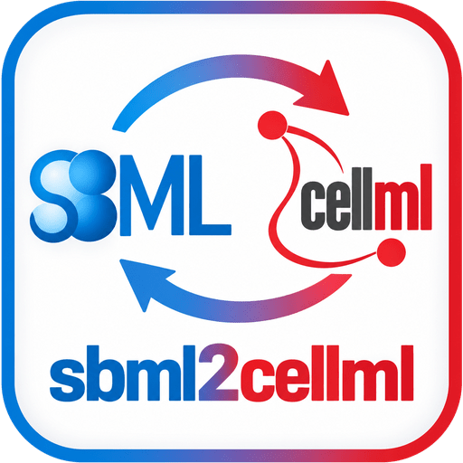

{ width="150" }

# sbml2cellml: conversion between SBML and CellML
[](https://github.com/matthiaskoenig/sbml2cellml/actions/workflows/ci-cd.yml) [](https://matthiaskoenig.github.io/sbml2cellml) [](https://pypi.org/project/sbml2cellml/) [](https://pypi.org/project/sbml2cellml/) [](https://opensource.org/licenses/MIT)

`sbml2cellml` converts between [SBML (Systems Biology Markup Language)](https://sbml.org) and [CellML 2.0](https://cellml.org), so that a model developed with one tooling can be used, simulated and shared in the other ecosystem. The source code is available from [https://github.com/matthiaskoenig/sbml2cellml](https://github.com/matthiaskoenig/sbml2cellml).

## Online converter

Convert a model in either direction here. The conversion runs in the browser: the page loads the converter as a WebAssembly module and reads the model locally, so nothing is uploaded and no server sees the model. A CellML model which imports a component or units, an SBML model which uses a package such as `comp`, and the metadata of a conversion need the [python package](installation.md).

<div class="converter" data-converter data-module="converter/sbml2cellml.wasm">
  <div class="converter__tabs" role="tablist" aria-label="Direction of the conversion">
    <button class="converter__tab converter__tab--active" type="button" role="tab" aria-selected="true" data-direction="cellml2sbml">CellML to SBML</button>
    <button class="converter__tab" type="button" role="tab" aria-selected="false" data-direction="sbml2cellml">SBML to CellML</button>
  </div>
  <div class="converter__panel" data-panel="cellml2sbml" data-example="roundtrip/repressilator.cellml">
    <label class="converter__drop" data-role="drop">
      <input id="converter-cellml" name="cellml" type="file" accept=".cellml,.xml" hidden>
      <span class="converter__prompt">Drop a CellML file here or <strong>choose a file</strong></span>
      <span class="converter__hint">CellML 2.0, 1.1 and 1.0, up to 32 MiB</span>
    </label>
    <div class="converter__actions">
      <button class="converter__button" type="button" data-action="example">Convert the repressilator</button>
      <button class="converter__button" type="button" data-action="download" disabled>Download</button>
      <button class="converter__button" type="button" data-action="copy" disabled>Copy</button>
    </div>
    <p class="converter__status" data-role="status" data-kind="info" role="status"></p>
    <details class="converter__warnings" data-role="warnings" hidden>
      <summary>Warnings of the conversion</summary>
      <ul data-role="warning-list"></ul>
    </details>
    <div class="converter__result" data-role="result" hidden>
      <pre class="converter__code"><code data-role="code"></code></pre>
    </div>
  </div>
  <div class="converter__panel" data-panel="sbml2cellml" data-example="roundtrip/repressilator.xml" hidden>
    <label class="converter__drop" data-role="drop">
      <input id="converter-sbml" name="sbml" type="file" accept=".xml,.sbml" hidden>
      <span class="converter__prompt">Drop an SBML file here or <strong>choose a file</strong></span>
      <span class="converter__hint">SBML level 1, 2 and 3, up to 32 MiB</span>
    </label>
    <div class="converter__actions">
      <button class="converter__button" type="button" data-action="example">Convert the repressilator</button>
      <button class="converter__button" type="button" data-action="download" disabled>Download</button>
      <button class="converter__button" type="button" data-action="copy" disabled>Copy</button>
    </div>
    <p class="converter__status" data-role="status" data-kind="info" role="status"></p>
    <details class="converter__warnings" data-role="warnings" hidden>
      <summary>Warnings of the conversion</summary>
      <ul data-role="warning-list"></ul>
    </details>
    <div class="converter__result" data-role="result" hidden>
      <pre class="converter__code"><code data-role="code"></code></pre>
    </div>
  </div>
</div>

## Features

- conversion of compartments, parameters, species, assignment and rate rules, reactions and events into a single CellML component
- conversion of the units: unit definitions, the units of numbers and, for a model with a complete unit annotation, the units of every variable
- names, notes, SBO terms, annotations and the model history as RDF next to the CellML model, restored in the conversion back to SBML
- conversion of CellML models to SBML: parameters with rules, unit definitions and units of numbers, resets as events, imports resolved, CellML 1.0 and 1.1 read in the permissive mode of libcellml, the components optionally as `comp` submodels (`--hierarchical`)
- the online converter of the documentation, which converts a model in either direction in the browser with a WebAssembly module of the rust converters, without an upload ([Online converter](#online-converter))
- conversion of a hierarchical SBML model: the `comp` submodels are flattened before the model becomes CellML
- validation of the result with [libcellml](https://libcellml.org/)
- timecourse simulation of the SBML with [sbmlsim-core](https://matthiaskoenig.github.io/sbmlsim-core/) and of the CellML with [libopencor](https://opencor.ws/libopencor/), both optional, see [Simulation](simulation.md)
- the `sbml2cellml` and `cellml2sbml` command lines
- the SBML test suite harness: every semantic case through both converters and both simulators, results on the [SBML test suite](testsuite.md) page
- the same check for the manually curated models of [BioModels](https://www.biomodels.org), results on the [BioModels](biomodels.md) page
- the same check for the CellML models of the [Physiome Model Repository](https://models.physiomeproject.org), from the CellML side, results on the [Physiome](physiome.md) page
- an overview of which models of the three checks work, on the [Models](models.md) page
- the wall time of the two simulators over the same models, on the [Benchmarks](benchmarks.md) page

## Quickstart

```python
from pathlib import Path
from sbml2cellml import convert_sbml2cellml

model = convert_sbml2cellml(Path("model.xml"), cellml_path=Path("model.cellml"))
```

or on the command line:

```bash
sbml2cellml model.xml -o model.cellml
cellml2sbml model.cellml -o model.xml
```

The conversion is validated with [libcellml](https://libcellml.org/); the resulting file can be simulated with [libopencor](https://opencor.ws/libopencor/) and compared with the sbmlsim-core simulation of the SBML model, see [Simulation](simulation.md). The [roundtrip example](roundtrip.md) shows the complete pipeline for the repressilator: the scripts, the three models and their simulations side by side.

## What is converted

The converter puts every SBML compartment, parameter and species as a variable into a single CellML component, together with the variable of integration `time` when the model has differential equations (rate rules or reactions).

| SBML | CellML |
| --- | --- |
| compartment | variable with the size as initial value |
| parameter | variable with the value as initial value |
| species | variable in amount (`hasOnlySubstanceUnits`) or concentration |
| species in concentration whose compartment changes in time | a second variable `<species>_amount` which the reactions change, and the equation `species = amount / compartment`: the amount is kept when the size changes, not the concentration |
| assignment rule | equation; its target has no initial value, the equation defines it from the start |
| rate rule | differential equation |
| reaction | variable of its rate with the kinetic law as equation; the rate times the stoichiometry is added to the differential equation of every reactant and product which is not a boundary species, divided by the size of the compartment for a species in concentration |
| conversion factor of a species or the model | factor of the reaction terms of the species |
| species reference with an id | variable of its stoichiometry, which rules may set |
| `<stoichiometryMath>` of a species reference (level 1 and 2) | variable `__stoichiometry_<reaction>_<role>_<index>` with the formula as its equation, the number itself when the formula is one |
| reaction id in a formula | the variable of the rate of the reaction |
| unit definition | units of the same name; the scale becomes the prefix, the multiplier `m` of a unit with the exponent `e` becomes `m^e` (CellML applies the exponent to the prefix only) |
| unit kinds `item` and `avogadro` | new base units `item`, dimensionless units `avogadro` with the multiplier 6.02214179e23; every other unit kind is a standard unit of CellML |
| units of a compartment, parameter or species | units of the variable when the unit annotation of the model is complete, else every variable is `dimensionless`, see [Units](conversion.md#units) |
| numbers in formulas | real numbers with their units, `dimensionless` when they have none |
| time and avogadro symbols | the variable of integration `time` (another name when an element of the model is called `time`), the number 6.02214179e23 |
| id which is a symbol of the formula syntax of libsbml (`avogadro`, `pi`, `NaN`, `true`) | variable of that name like every other id: the formulas are converted as the MathML trees of the model, never as text |
| rateOf symbol | the right-hand side of the differential equation of its variable, 0 without one |
| delay symbol | not yet |
| rule or kinetic law without math | ignored, it has no effect |
| initial assignment | evaluated to the initial value; without math it has no effect |
| infinite or NaN value | the equation `x = INF` (or `-INF`, `NaN`), not for a state |
| function definition | calls replaced by the body of the function |
| names, notes, SBO terms, annotations (CV terms) and the model history | RDF file next to the CellML file which points at the `id` of the elements, see [Metadata](conversion.md#metadata); `cellml2sbml` reads it back |
| local parameter of a kinetic law | variable `<reaction>_<parameter>` (numeric suffix when taken) |
| event | resets: the variable `<event>_trigger` is `piecewise(1, trigger, 0)` and every assignment a reset which fires when it reaches 1; an event with a delay is skipped with a warning |
| algebraic rule | implicit equation `0 = formula` for the variable the rule determines, which starts from the solution at the start time; the constants of the rule become equations `y = value` |
| `plus`, `times`, `and`, `or`, `xor` with less than two arguments | their value (the argument or the identity element) |
| relation of more than two arguments (`a < b < c`) | the conjunction of its pairs, `and(a < b, b < c)` |
| `quotient`, `implies` | `piecewise(ceiling(a / b), a / b < 0, floor(a / b))`, the integer division which truncates towards zero, and `not a or b`: CellML has neither operator |
| `factorial` | not converted, CellML has no counterpart; an event which uses it is skipped |

The reverse direction, [CellML to SBML](conversion.md#cellml-to-sbml), maps every variable to a parameter with rules and converts units and resets.

The [conversion issues](conversion-issues.md) list what is not converted yet, the [SBML test suite](testsuite.md), [BioModels](biomodels.md) and [Physiome](physiome.md) pages how many of the semantic test cases, of the curated models and of the published CellML models pass. The [Models](models.md) page collects which models of the three checks work and the [Benchmarks](benchmarks.md) page how fast the two simulators are over them.

The [release notes](release-notes/index.md) list the changes of every version.

## Citation

[](https://doi.org/10.5281/zenodo.22829187)

If you use `sbml2cellml` please cite the archived software on [Zenodo](https://doi.org/10.5281/zenodo.22829187):

> König, M. (2026). *sbml2cellml: conversion of SBML models to CellML* (Version 0.4.3) [Computer software]. Zenodo. https://doi.org/10.5281/zenodo.23554440

```bibtex
@software{konig_sbml2cellml,
  author    = {König, Matthias},
  title     = {sbml2cellml: conversion of SBML models to CellML},
  year      = {2026},
  month     = oct,
  version   = {0.4.3},
  publisher = {Zenodo},
  doi       = {10.5281/zenodo.23554440},
  url       = {https://doi.org/10.5281/zenodo.23554440},
}
```

## License

- Source Code: [MIT](https://opensource.org/license/MIT)
- Documentation: [CC BY-SA 4.0](http://creativecommons.org/licenses/by-sa/4.0/)

## Funding

Matthias König was supported by the Federal Ministry of Education and Research (BMBF, Germany) within the research network Systems Medicine of the Liver (LiSyM, grant number 031L0054) and within ATLAS by grant number 031L0304B, and by the German Research Foundation (DFG) within the Research Unit Program FOR 5151 QuaLiPerF (Quantifying Liver Perfusion-Function Relationship in Complex Resection - A Systems Medicine Approach) by grant number 436883643 and by grant number 465194077 (Priority Programme SPP 2311, Subproject SimLivA).
