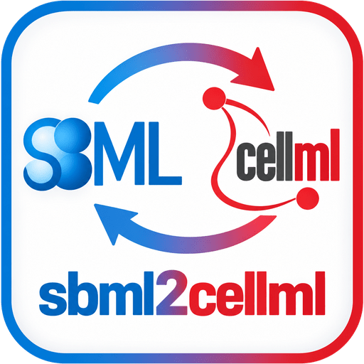

# Release notes for sbml2cellml 0.5.0

The SBML models of the checks are simulated with [sbmlsim-core](https://matthiaskoenig.github.io/sbmlsim-core/) instead of roadrunner ([#65](https://github.com/matthiaskoenig/sbml2cellml/issues/65)) and the semantic cases come from a pinned commit of the repository of the SBML test suite instead of its latest release ([#64](https://github.com/matthiaskoenig/sbml2cellml/issues/64)). With libcellml 0.7.2 Windows is supported again and the workaround for the code it generated for a negation is gone. The package requires python 3.14.

## Features
- new module [`sbml2cellml.sbmlsim`](https://matthiaskoenig.github.io/sbml2cellml/api/sbmlsim/): `run_timecourse` simulates an SBML file or document with sbmlsim-core, which compiles the model to WebAssembly and integrates it with CVODE of SUNDIALS. `compilable_sbml` gives the compiler what it reads: a level 1 or 2 model is converted to level 3 version 2 and a model which requires the `comp` package is flattened, both with libsbml. A species in brackets (`[S1]`) is selected as concentration, as in the CellML model of the conversion
- the absolute tolerance of a simulation follows the states of the model: `run_timecourse` multiplies it with the smallest initial value of a state when it is below one (`state_scale`), as roadrunner does. The states of an SBML model are the amounts of its species, so a species with the concentration 1 in a compartment of 1e-13 litre has the amount 1e-13, below an absolute tolerance of 1e-12, and CVODE would accept any trajectory of it
- the reports of the test suite and of BioModels have a timing section: the total, the median, the 95th percentile and the slowest simulation of every stage, and a figure of the libopencor time against the sbmlsim-core time per case on logarithmic axes. The wall time of every simulation is in `testsuite/results.json` and `biomodels/results.json` (`seconds` of a stage), measured around the call of the simulator with the compilation of the model included. sbmlsim-core simulates the median case of the test suite in 1.4 ms and libopencor in 5.4 ms
- the SBML test suite harness and the BioModels check simulate the SBML models with sbmlsim-core, the stage `roadrunner` is now `sbmlsim`: 1533 of the 1535 cases simulate instead of 1384, and the `roundtrip` stage passes 1044 cases instead of 962, because algebraic rules and delays are no longer a limit of the reference simulator
- both simulators run in one python process, so the roundtrip tests, the roundtrip example and the harness no longer work around the LLVM clash of roadrunner and libopencor
- the semantic cases are fetched from the pinned commit `bbcbc80` of the [repository of the suite](https://github.com/sbmlteam/sbml-test-suite) (a partial `git` clone of `cases/semantic`, about 80 MB) instead of the 3.5.0 release: fixed expected results are in the repository long before they are released. `SUITE_COMMIT` of `sbml2cellml.testsuite.cases` is the commit, the report links it
- Windows is supported again and tested: the Windows wheels of libcellml 0.7.2 contain x64 binaries ([cellml/libcellml#1460](https://github.com/cellml/libcellml/issues/1460)), and the test matrix runs python 3.14 on linux, macOS and Windows

## Changes
- python 3.14 is required (python 3.13 is dropped): sbmlsim-core needs it
- libcellml 0.7.2 and libopencor 1.20261113.0 are the floors; `libroadrunner` is no longer a dependency of any extra
- the `simulate` extra installs both simulators (libopencor and sbmlsim-core) together with pandas and matplotlib; the `testsuite` extra adds `requests` for the models of BioModels, the cases of the suite need `git`
- the formulas of the CellML model keep the negations of the SBML model: libcellml 0.7.2 generates `-(-2.0*a)` where 0.7.1 generated `--2.0*a`, a decrement in C which libopencor could not compile, so a negative number is written as a negative real and a negated product stays as it is. The CellML of a model with negative numbers differs from the one of 0.4.3
- `examples/roadrunner_timecourse.py` is gone, the roundtrip example simulates the SBML models with `sbml2cellml.sbmlsim`
- `sbml2cellml.testsuite.runner.roadrunner_selections` is `selections`, and `INTEGRATOR_FAILURE` is `INTEGRATOR_FAILURES` (libopencor names CVODE, sbmlsim-core raises an `IntegrationError`)
- the stage of the SBML simulation is `sbmlsim` in `testsuite/results.json`, `biomodels/results.json` and both reports

## Fixes
- a model which requires the `comp` package is flattened before the reference simulation, so a model which only declares ports (e.g. the glimepiride models) is simulated instead of refused
- a level 1 or 2 model which libsbml refuses to convert strictly to level 3 version 2, over issues which have no mathematics such as the `outside` attribute of a compartment, is converted without the strict check and the issues are logged as a warning: 1043 of the 1045 curated BioModels without an SBML package compile now
- the linux jobs of the workflows run on `ubuntu-24.04`: `ubuntu-latest` is ubuntu 26.04 now, which ships libxml2 2.15 as `libxml2-16` with the soname `libxml2.so.16`, while the wheels of libcellml link `libxml2.so.2`

## Limitations
- libcellml 0.7.2 reduces a unit with a multiplier and an exponent as the specification does ([cellml/libcellml#1463](https://github.com/cellml/libcellml/issues/1463) is fixed), but its analyser still reports equations whose two sides reduce to the same base units as not equivalent ([cellml/libcellml#1229](https://github.com/cellml/libcellml/issues/1229)); the warnings do not make a model invalid
- libopencor 1.20261113.0 does not apply the resets of a CellML model
- the two cases with a variable named `time` (01820, 01821) fail the `sbmlsim` stage, as they did with roadrunner
- events, the delay symbol and coupled algebraic rules are not converted
- see the conversion issues in the documentation

Your sbml2cellml team
