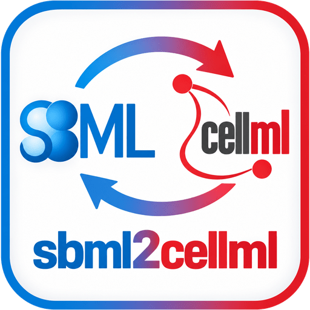

# Release notes for sbml2cellml 0.6.0

Both conversions run in rust ([#68](https://github.com/matthiaskoenig/sbml2cellml/issues/68), [#82](https://github.com/matthiaskoenig/sbml2cellml/issues/82)): the reader and the writer of CellML, the conversion of a CellML model to SBML and the conversion of an SBML model to CellML are crates of this repository, which the package calls through the module `sbml2cellml._rust` and which the documentation runs in the browser as WebAssembly. The landing page converts a model in either direction without an upload and simulates both sides of the conversion next to each other, with libopencor on the CellML side and sbmlsim-core on the SBML side. The events of a model keep their semantics through the roundtrip, the components of a CellML model can become `comp` submodels, and the published models of the Physiome Model Repository are a third check next to the SBML test suite and BioModels.

## Features
- the conversion of a CellML model to SBML in rust ([#78](https://github.com/matthiaskoenig/sbml2cellml/issues/78), [#80](https://github.com/matthiaskoenig/sbml2cellml/issues/80)): `crates/cellml` reads CellML 2.0, 1.1 and 1.0 and writes a model as a CellML 2.0 document, `crates/sbml` is the SBML level 3 version 2 document the conversion writes with its own XML writer, and `crates/convert` is the conversion, which reads what the equations of a model determine where the python converter asks the analyser of libcellml. The resets of a component become the events of SBML, and a model whose rate equations give each other's rate is refused instead of being written as a model which does not move ([cellml/libcellml#1531](https://github.com/cellml/libcellml/issues/1531))
- the conversion of an SBML model to CellML in rust ([#84](https://github.com/matthiaskoenig/sbml2cellml/issues/84), [#85](https://github.com/matthiaskoenig/sbml2cellml/issues/85), [#90](https://github.com/matthiaskoenig/sbml2cellml/issues/90), [#91](https://github.com/matthiaskoenig/sbml2cellml/issues/91), [#92](https://github.com/matthiaskoenig/sbml2cellml/issues/92), [#94](https://github.com/matthiaskoenig/sbml2cellml/issues/94)): `crates/tocellml` reads the document with `sbmlsim-sbml` of sbmlsim-core, which reads every level and version of SBML core, and writes the units, the structure, the mathematics with the function definitions expanded, the evaluation of the model at the start, the events as resets and the algebraic rules as implicit equations
- the module `sbml2cellml._rust` (`crates/python`, pyo3 with the stable ABI of python 3.14) is built into the wheel by maturin, which is the build backend of the package: `uv sync` and `uv build` compile the crates, and the release publishes the wheels of linux (x86_64, aarch64), macOS (universal2) and windows together with the source distribution
- `convert_sbml2cellml` and `convert_cellml2sbml` take the `engine` to convert with and both commands the flag `--engine`: `auto`, the default, converts with rust and takes python for what rust does not write, `rust` and `python` pin one engine. The rust engine converts the median model of the Physiome selection 48 times faster than the python engine and the median SBML model twice as fast, where the conversion alone, which is what a browser runs, is 288 and 21 times faster; `scripts/convert_benchmark.py` measures both engines of both directions over the corpus
- the [online converter](https://matthiaskoenig.github.io/sbml2cellml/#online-converter) of the landing page converts a model in either direction in the browser ([#79](https://github.com/matthiaskoenig/sbml2cellml/issues/79)): `crates/wasm` is the converter built for `wasm32-unknown-unknown` (607 KiB), the page reads the document from the file of the visitor, shows the warnings of the conversion and offers the result as a download, and nothing is uploaded. The repressilator is converted in 8 ms, 1.5 ms once the module is loaded
- the [online simulator](https://matthiaskoenig.github.io/sbml2cellml/#online-simulator) below it simulates a published model and its conversion next to each other, with one set of sliders for the parameters of both: a model of BioModels is an SBML model and becomes CellML in the page, a model of the Physiome Model Repository is a CellML model and becomes SBML, libopencor integrates the CellML side and sbmlsim-core compiles and integrates the SBML side, and the largest difference between the two simulations is printed below the plots. The selection is twelve models, `scripts/build_simulator_models.py` writes it and refuses a model whose two simulations differ at the published values or with any slider moved
- the online converter simulates both sides of a conversion the same way ([#101](https://github.com/matthiaskoenig/sbml2cellml/issues/101)), and the [roundtrip example](https://matthiaskoenig.github.io/sbml2cellml/roundtrip/) opens with the interactive simulation of the repressilator, whose SBML model is compiled in the browser with the compiler of sbmlsim-core 0.23.0, so no asset of a page is compiled ahead of time
- the events of a model keep their semantics through the roundtrip ([#106](https://github.com/matthiaskoenig/sbml2cellml/issues/106)): a reset of CellML has no delay, no priority and none of the flags of an SBML event, so the delay, the priority, `initialValue`, `persistent` and `useValuesFromTriggerTime` go into the metadata of the conversion under the trigger variable of the event, which `cellml2sbml` applies to the event again. An event with a delay becomes resets which fire when the trigger holds instead of being dropped, and a species in a compartment an event sets follows the size of that compartment. The SBML test suite roundtrips 1601 of its 1658 cases, where 1322 roundtripped before
- the components of a CellML model become `comp` submodels with `--hierarchical` ([#74](https://github.com/matthiaskoenig/sbml2cellml/issues/74)), one model definition per component, an encapsulated component a submodel of its parent and every equivalence set of more than one variable a parameter of the main model with a `ReplacedElement` per member; the flattened hierarchical model is the flat conversion of the same model
- the [Physiome check](https://matthiaskoenig.github.io/sbml2cellml/physiome/) runs curated published models of the Physiome Model Repository through the pipeline from the CellML side, with the libopencor simulation of the published model as the expected results
- the [model overview](https://matthiaskoenig.github.io/sbml2cellml/models/) and the [benchmarks](https://matthiaskoenig.github.io/sbml2cellml/benchmarks/) are rendered from the committed results of the three checks ([#75](https://github.com/matthiaskoenig/sbml2cellml/issues/75), [#76](https://github.com/matthiaskoenig/sbml2cellml/issues/76)): every model of BioModels and of the Physiome Model Repository with the status of its stages, and the wall time of libopencor against the wall time of sbmlsim-core for the setup, the integration and the two together. 940 of the 1060 models of BioModels and 56 of the 66 models of the Physiome Model Repository pass every stage of their check
- both simulators take the same call: `sbml2cellml.sbmlsim.run_timecourse` and `sbml2cellml.simulate.run_timecourse` have the same signature and return a frame with the variable of integration in the first column, `selections` is optional on both sides, the units and the wall times are filled into the dictionaries given for them, and `plot_timecourse` plots the frame of either simulator

## Changes
- `auto` is the default engine of both conversions, which converts with rust; the python engine converts the hierarchical conversion and a model the rust converter refuses
- `quotient(a, b)` is the integer division of the OpenMath dictionary which the MathML of SBML follows and truncates towards zero, where both converters wrote a floor: it is written as `piecewise(ceiling(a / b), a / b < 0, floor(a / b))`
- the `<stoichiometryMath>` of a species reference of level 1 or 2 becomes the variable `__stoichiometry_<reaction>_<role>_<index>` with its formula as the equation, where the python converter used the stoichiometry attribute and dropped the formula
- a factorial of a constant is folded to the number it stands for, and an n-ary operator of less than two arguments is written as its value (`max(a)` is `a`)
- sbmlsim-core 0.23.0 is the floor, whose compiler runs in the browser, and the reader of SBML of the rust workspace is `sbmlsim-sbml` of crates.io
- the documentation leads with the tools: the online converter and the online simulator are the first sections of the landing page, the interactive simulation is the first section of the roundtrip page and loads the simulators when the page opens
- `sbml2cellml.testsuite.results` carries the stages of a run, so the report code of the test suite renders the BioModels and the Physiome check as well

## Fixes
- a formula which the MathML of CellML 2.0 cannot express is refused with its operator and its formula instead of being written ([#111](https://github.com/matthiaskoenig/sbml2cellml/pull/111)): the conversion wrote a `delay`, a `factorial` of a variable and an unresolved `rateOf` as the SBML model has them, which produced a document libcellml refuses to read, and 48 cases of the test suite reported a wall of validation errors about a `csymbol`. The failures of the `sbml2cellml` stage are 46 now, each with its formula in the report, and `libopencor` passes 1158 cases
- a unary `min` or `max`, which crashes the generator of libcellml 0.7.2 and takes libopencor with it ([cellml/libcellml#1533](https://github.com/cellml/libcellml/issues/1533)), is written as its argument, so the cases 01280 and 01281 are simulated
- an event whose `<delay>` has no mathematics is converted instead of being skipped, which case 01241 requires
- a negative zero which libsbml evaluates an initial assignment to is written as the zero of the model
- the BioModels check gains BIOMD0000000437, a model with a species named `time`: the comparison takes the time points of a result by their position and every variable by its name
- the workflows check a pull request whatever its base, so a pull request which is stacked on another one is checked as well ([#88](https://github.com/matthiaskoenig/sbml2cellml/issues/88))
- the ruff and the ty hook of `pre-commit` run the versions of the lock file again

## Limitations
- CellML 2.0 has no `delay`, no `factorial` of a variable and no `rateOf` of its own, so a model whose formulas use them is refused: 43 cases of the test suite hold a delay and 3 a factorial of a variable
- libopencor 1.20261113.0 does not apply the resets of a CellML model ([opencor/libopencor#596](https://github.com/opencor/libopencor/issues/596)), so the `libopencor` stage of a model with events reports the difference
- the generator of libcellml 0.7.2 writes the operand of a `not` without parentheses, `!voi > 5.5` for `not(voi > 5.5)` ([cellml/libcellml#1532](https://github.com/cellml/libcellml/issues/1532)): the document is valid and only the generated code is wrong, so the conversion writes the `not` of the model and warns about every equation which holds one
- the analyser of libcellml still reports equations whose two sides reduce to the same base units as not equivalent ([cellml/libcellml#1229](https://github.com/cellml/libcellml/issues/1229)); the warnings do not make a model invalid
- the permissive parser of libcellml reads the interface of a variable of CellML 1.0 from the presence of `public_interface` and `private_interface` and not from their values ([cellml/libcellml#1528](https://github.com/cellml/libcellml/issues/1528)); the rust reader takes the value
- the two cases with a variable named `time` (01820, 01821) report the variable the simulator does not return
- an implicit equation whose variables an event writes does not roundtrip
- see the conversion issues in the documentation

Your sbml2cellml team
